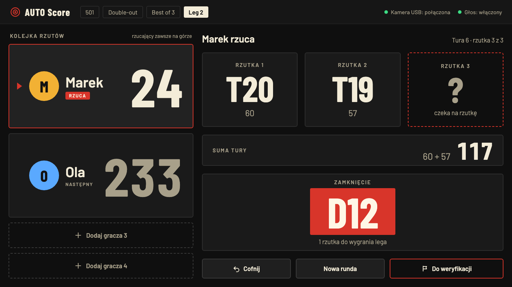
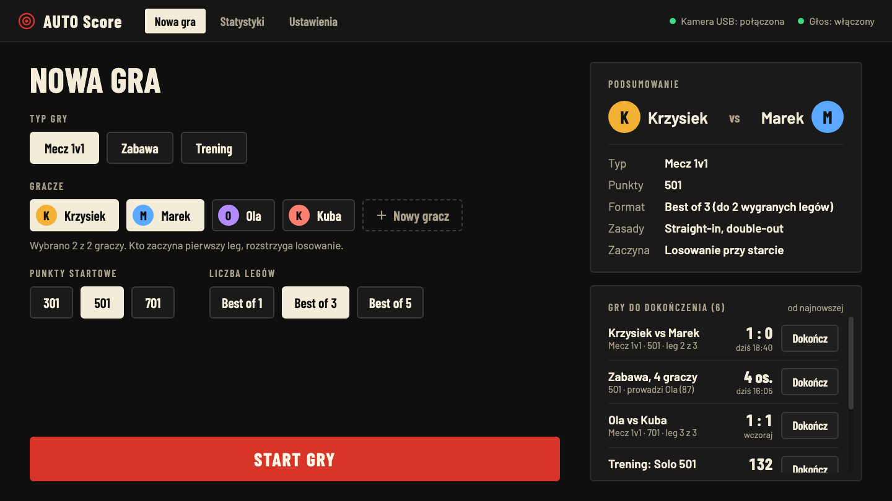
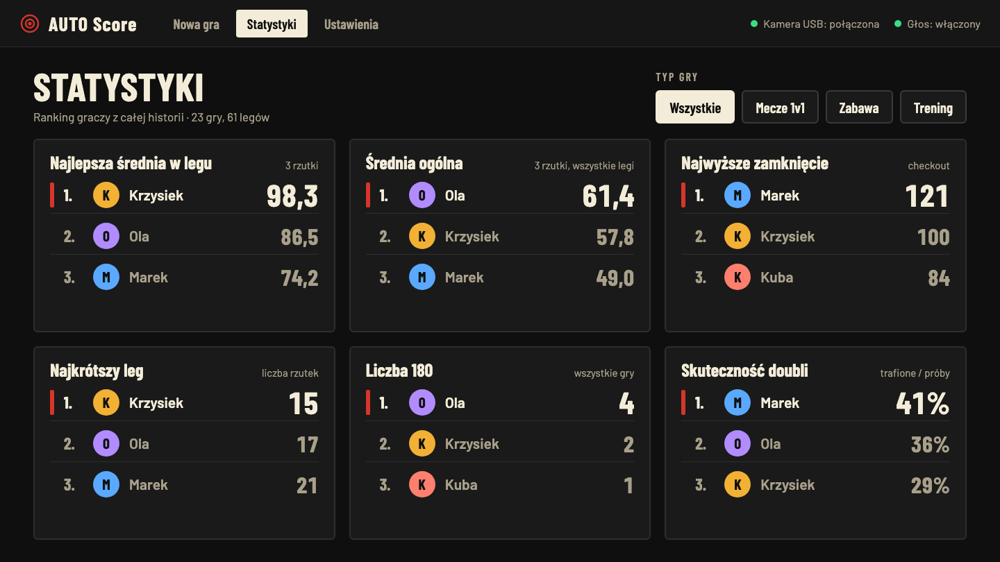

# AUTO Score

AUTO Score automatycznie liczy wynik w darcie. Dziś trafienia wpisuje się ręcznie na klawiaturze w aplikacji (symulator trafień). Później źródłem trafień będzie kamera USB. Wyjście to wynik na żywo, głosowy odczyt wyniku i efekty dźwiękowe. Projekt działa lokalnie: serwer, baza i front stoją na jednym komputerze w sieci domowej, bez internetu.

## Stan projektu

Działa na `main`:

- typy gier: mecz 1v1 (X01), zabawa dla 2-4 graczy z rankingiem miejsc, trening (Free run, Solo 501 i „Końcówki”: losowe końcówki z przedziału 2-50 albo 51-100, z podpowiedzią trasy i przyciskami „Udało się”, „Nie udało się” i „Nowa końcówka”. Po pudle końcówka zostaje do ponownej próby),
- kreator nowej gry: typ gry, lista graczy, dodawanie gracza (imię, avatar emoji, kolor, gość), punkty startowe, liczba legów w meczu 1v1, tryb treningu i przedział końcówek,
- ekran gry: pasek wyników, trzy sloty rzutek, suma tury, podpowiedź zamknięcia, klawiatura (1-20, 25, Miss, S/D/T) i przycisk „Cofnij”,
- stan na żywo przez WebSocket, z ponownym połączeniem po zerwaniu,
- głosowy odczyt wyniku tury, komunikaty „Bust” i „Zwycięzca” oraz efekty dźwiękowe, każde z przełącznikiem na ekranie gry.

Jeszcze nie ma:

- Statystyk i ekranu podsumowania lega lub meczu.
- Historii meczów oraz przerywania i wznawiania gry.
- Działających przycisków „Nowa runda” i „Do weryfikacji”. Nie ma ich na ekranie gry, dopóki nie dostaną działania.
- Obsługi `confidence`. Serwer zapisuje to pole, ale go nie używa (nie ma jeszcze statusu `pending`).
- Kamery. Detekcja przyjdzie w etapie 2.

Etap 1 (Mac bez kamery) nie jest jeszcze skończony.

## Wymagania

- Node 24. `nvm use` czyta wersję z `.nvmrc`.
- pnpm 12. Dokładna wersja jest w polu `packageManager` w `package.json`.
- Dziś macOS. Docelowo mini PC z Linuksem.

## Instalacja i uruchomienie

```sh
nvm use
pnpm install
pnpm dev
```

`pnpm dev` uruchamia równolegle serwer (`http://localhost:3000`) i front (domyślnie `http://localhost:5173`). Aplikację otwierasz pod adresem frontu. Serwer z `pnpm dev` działa bez hasła, bo skrypt ustawia `AUTOSCORE_AUTH=off`, chyba że zmienna jest już ustawiona.

Tablet w tej samej sieci otwiera `http://<adres-IP-komputera>:5173`. Tablet potrzebuje tylko portu 5173, bo front przekazuje zapytania do API przez proxy `/api`. Jeśli macOS pyta o połączenia przychodzące, zezwól na nie w zaporze (Ustawienia systemowe, Sieć, Zapora).

Serwer przy starcie wykonuje migracje bazy. Plik bazy powstaje domyślnie w `packages/server/autoscore.sqlite`, bo pnpm uruchamia skrypty w katalogu pakietu. Pliki `*.sqlite` są w `.gitignore`.

Sam serwer, bez frontu, bez trybu watch i bez hasła:

```sh
AUTOSCORE_AUTH=off pnpm --filter @autoscore/server start
```

## Konfiguracja

Konfiguracja idzie przez zmienne środowiskowe.

| Zmienna | Domyślnie | Znaczenie |
|---|---|---|
| `PORT` | `3000` | Port serwera API. |
| `HOST` | `0.0.0.0` | Adres nasłuchu serwera. Domyślny pozwala połączyć się z innych urządzeń w sieci. |
| `DATABASE_PATH` | `autoscore.sqlite` | Ścieżka pliku SQLite, względna wobec katalogu, w którym działa proces serwera. |
| `AUTOSCORE_AUTH` | `on` | `on` wymaga hasła w `AUTOSCORE_PASSWORD`, bez niego serwer nie wstaje. `off` wyłącza logowanie, tylko do pracy lokalnej. `AUTOSCORE_PASSWORD`, `AUTOSCORE_TOKEN_SECRET` i błędy startu opisuje [README serwera](packages/server/README.md). |
| `AUTOSCORE_API_URL` | `http://localhost:3000` | Adres serwera, na który proxy Vite przekazuje `/api`. |
| `AUTOSCORE_MATCH_LOCK_MINUTES` | `5` | Ile minut po rzutce kończącej grę da się jeszcze cofać. `0` zamyka grę od razu. Wartość spoza samych cyfr albo większa niż `525600` (rok) zatrzymuje start z błędem `Invalid AUTOSCORE_MATCH_LOCK_MINUTES`. |

`PORT` musi składać się z samych cyfr i nie przekraczać 65535. Inaczej serwer kończy pracę przy starcie z błędem `Invalid PORT`. Po zmianie `PORT` ustaw `AUTOSCORE_API_URL` na ten sam port, na przykład:

```sh
PORT=3100 AUTOSCORE_API_URL=http://localhost:3100 pnpm dev
```

## API w skrócie

Typy żądań, odpowiedzi i wiadomości są zdefiniowane tylko w [packages/schema](packages/schema/README.md) (Zod).

| Metoda | Ścieżka | Opis |
|---|---|---|
| `GET` | `/players` | Lista graczy bez gości, posortowana po imieniu. |
| `POST` | `/players` | Nowy gracz (`CreatePlayerRequest`: `name` 1-40 znaków po obcięciu spacji, opcjonalny `avatar` (dokładnie jedno emoji, np. 🎯, 👍🏽 albo 🇵🇱; tekst daje 400), opcjonalny `color` 1-16, `guest` domyślnie `false`). Bez `color` gracz dostaje stały kolor wyliczony z `id`. Odpowiedź 201 z `Player`. Imię zajęte przez innego zapisanego, niezarchiwizowanego gracza daje 409 `player_name_taken` (nie dotyczy gości). |
| `POST` | `/matches` | Nowa gra (`CreateMatchRequest`, rodzaj w polu `type`). Odpowiedź 201 z `MatchSnapshot`. |
| `GET` | `/matches/:id` | Bieżący stan gry (`MatchSnapshot`). |
| `POST` | `/matches/:id/throws` | Rzutka (`HitEvent`). Odpowiedź 201 z `{ throw, events, state }`. |
| `POST` | `/matches/:id/checkout-attempts` | Próba w treningu checkoutów (`CheckoutAttemptRequest`: `{ success }`). Odpowiedź 201 z `MatchSnapshot`. Po udanej próbie `checkouts` ma nowy cel, po nieudanej ten sam. Sesje zapisane przed wprowadzeniem tej zasady dostają nowy cel po każdej próbie. Inna gra daje 409 `not_checkouts`, zakończony trening 409 `practice_ended`, a porzucony 409 `match_abandoned`. |
| `POST` | `/matches/:id/checkout-skips` | Pominięcie celu w treningu checkoutów: nowy cel bez próby. Body jest opcjonalne (`CommandRequest`: `{ expectedSeq }`, patrz niżej). Odpowiedź 201 z `MatchSnapshot`, w którym `attempts`, `successes` i `history` się nie zmieniają, a `skips` rośnie o 1. Błędy jak przy próbie, nieznana gra daje 404 `not_found`. |
| `POST` | `/matches/:id/rest-miss` | Miss na resztę tury rzucającego (`RestMissRequest`: `{ eventId, expectedSeq? }`). Zapisuje 3, 2 albo 1 rzutkę (przy 0, 1 albo 2 rzutkach w turze) w jednej transakcji, ze `source: "rest-miss"`. Pierwsza dostaje `eventId` z żądania. Odpowiedź 201 z `{ throws, events, state }` (`RestMissResult`). Ponowne wysłanie tego samego `eventId` daje 200 z `throws: []`. Błędy jak przy rzutce: zakończona gra daje 409 `match_finished`, trening checkoutów 409 `throws_not_allowed`. |
| `POST` | `/matches/:id/undo` | Cofnięcie ostatniej rzutki. Body jest opcjonalne (`CommandRequest`: `{ expectedSeq }`, patrz niżej). Odpowiedź 200 z `{ undoneThrowId, state }`. W zakończonej grze działa do `editableUntil` ze stanu gry (`finishedAt` plus `AUTOSCORE_MATCH_LOCK_MINUTES`), potem daje 409 `match_locked`. W treningu checkoutów cofa ostatnią próbę albo ostatnie pominięcie, przywraca poprzedni cel i zwraca `undoneThrowId: null`. |
| `GET` | `/matches/:id/summary` | Podsumowanie gry (`MatchSummary`). Każdy wygrany leg w `legs` ma `durationMs`: czas od pierwszej do zamykającej rzutki lega w milisekundach, bez przerw między porzuceniem a wznowieniem. Zabawa ma pustą listę `legs`. Nieznana gra daje 404 `not_found`. |
| `GET` | `/players/:id/stats` | Statystyki gracza (`PlayerStats`), w tym `winRate` (procent wygranych z ukończonych meczów 1v1 i gier w zabawie, z jednym miejscem po przecinku, `null` bez ukończonych gier) i `t20Hits` (trafienia T20 w zamkniętych turach, także z bustem). Parametry: `type` (`all`, `match`, `casual` albo `practice`, domyślnie `all`) i `period` (`30d`, `90d` albo `all`, domyślnie `all`). `30d` i `90d` liczą tylko gry z `createdAt` nie starszym niż zegar serwera minus 30 albo 90 dni. Odpowiedź ma pola `filter` i `period`. Nieznana wartość parametru daje 400 `invalid_request`, nieznany gracz 404 `not_found`. |
| `GET` | `/players/:id/form` | Forma gracza (`PlayerForm`): średnia z ukończonych legów każdej z ostatnich 20 gier. Parametry: `type` (`all`, `match`, `casual` albo `practice`, domyślnie `all`) i `period` (`30d`, `90d` albo `all`, domyślnie `all`). `30d` i `90d` liczą tylko gry z `createdAt` nie starszym niż zegar serwera minus 30 albo 90 dni. Odpowiedź ma pola `filter` i `period`. Nieznana wartość parametru daje 400 `invalid_request`. |
| `GET` | `/players/:id/head-to-head/:opponentId` | Bilans dwóch graczy z ukończonych meczów 1v1 (`HeadToHead`). Parametr `period` (`30d`, `90d` albo `all`, domyślnie `all`). `30d` i `90d` liczą tylko gry z `createdAt` nie starszym niż zegar serwera minus 30 albo 90 dni. Odpowiedź ma pole `period`. Nieznana wartość parametru albo ten sam gracz dwa razy daje 400 `invalid_request`. |
| `GET` | `/stats/rankings` | Ranking graczy i rekordy (`StatsRankings`), w tym lista `winRate` (gracze z co najmniej 3 ukończonymi meczami 1v1 albo grami w zabawie, pusta dla `practice`) i lista `t20Hits` (bez graczy z 0 trafień). Parametry: `type` (`all`, `match`, `casual` albo `practice`, domyślnie `all`) i `period` (`30d`, `90d` albo `all`, domyślnie `all`). `30d` i `90d` liczą tylko gry z `createdAt` nie starszym niż zegar serwera minus 30 albo 90 dni. Odpowiedź ma pola `filter` i `period`. Nieznana wartość parametru daje 400 `invalid_request`. |
| `GET` | `/stats/overall` | Wszystkie gry liczone do statystyk razem, bez filtra po typie (`StatsOverall`). Parametr `period` (`30d`, `90d` albo `all`, domyślnie `all`). `30d` i `90d` liczą tylko gry z `createdAt` nie starszym niż zegar serwera minus 30 albo 90 dni. Odpowiedź ma pole `period`. Nieznana wartość parametru daje 400 `invalid_request`. |
| WebSocket | `/matches/:id/live` | Strumień stanu i zdarzeń jednej gry. |

Rodzaje gry w `POST /matches`:

- `match`: dokładnie 2 różnych graczy w `playerIds`, `startingScore` 301, 501 lub 701 (domyślnie 301), `bestOf` 1, 3 lub 5 (domyślnie 1),
- `casual`: 2-4 różnych graczy i `startingScore` (domyślnie 301),
- `practice`: `practiceMode` `free_run`, `solo_501` albo `checkouts` i jeden gracz. `checkouts` wymaga `checkoutRange` (`2-50` albo `51-100`), a inne tryby go nie przyjmują.

Okres statystyk (`period`): `30d` i `90d` liczą tylko gry, których `createdAt` jest nie starsze niż teraz minus 30 albo 90 dni (gra sprzed dokładnie 30 dni wchodzi do `30d`). „Teraz” to zegar serwera, nie urządzenia. `90d` to ruchome 90 dni, nie kwartał. `all` nie ma granicy i daje te same liczby co zapytanie bez parametru. Najczęstsze trafienia i podsumowanie gry nie mają okresu.

### Zdarzenie trafienia (`HitEvent`)

```json
{
  "eventId": "6f1c2a9e-3b4d-4e5f-8a7b-9c0d1e2f3a4b",
  "matchId": "<MATCH_ID>",
  "source": "keypad",
  "sequence": 0,
  "segment": 20,
  "multiplier": 3,
  "confidence": 1,
  "detectedAt": "2026-10-18T18:30:12.345Z"
}
```

- `eventId`: UUID (małe lub wielkie litery). Ten sam `eventId` wysłany ponownie do tej samej gry nie dubluje rzutki.
- `source`: niepusty tekst, na przykład `keypad` albo `camera-1`.
- `sequence`: liczba całkowita od 0.
- `segment`: 0-20 albo 25. `multiplier`: 0-3.
- `confidence`: liczba od 0 do 1.
- `detectedAt`: data ISO w UTC zakończona `Z`. Przesunięcie strefy, na przykład `+02:00`, jest odrzucane.

Kodowanie: miss to `segment: 0, multiplier: 0`. Outer Bull to `segment: 25, multiplier: 1` (25 pkt). Bull to `segment: 25, multiplier: 2` (50 pkt, liczy się jako double). `segment: 25, multiplier: 3` jest odrzucane.

### Idempotencja i błędy

Ponowne wysłanie rzutki z tym samym `eventId` do tej samej gry daje 200 z zapisaną rzutką i `events: []`, jeśli `source`, `sequence`, `segment`, `multiplier`, `confidence` i `detectedAt` są takie same jak w zapisanej rzutce. Inna treść daje 409 `event_id_conflict`. W obu przypadkach serwer nic nie zapisuje i nic nie wysyła przez WebSocket. Ponowne wysłanie `rest-miss` z tym samym `eventId` działa tak samo i daje 200 z `throws: []`. Cofnięcie jest nowym wpisem w logu. Wiersz rzutki zostaje w bazie.

Siedem komend przyjmuje opcjonalne `expectedSeq`: cofnięcie, próba i pominięcie checkoutu, `rest-miss`, porzucenie (`POST /matches/:id/abandon`, `AbandonMatchRequest`), wznowienie (`POST /matches/:id/resume`) i koniec treningu (`POST /matches/:id/end`). `expectedSeq` to ostatni `eventSeq`, który widział klient. Inna wartość niż bieżący `eventSeq` gry daje 409 `stale_state` z bieżącym stanem, a serwer nic nie zapisuje i nic nie wysyła przez WebSocket. Bez `expectedSeq` komenda działa na bieżącym stanie, więc dwa cofnięcia z rzędu zdejmują dwie rzutki. Cofnięcie, wznowienie, koniec treningu i pominięcie checkoutu czytają body jako JSON przy każdym `content-type`. Pusty albo niepoprawny JSON i wartość, która nie jest obiektem, znaczą brak body. Obiekt z niepoprawnym `expectedSeq`, na przykład `-1` albo `"3"`, daje 400 `invalid_request`. Kolejność sprawdzeń: błąd body (400), nieznana gra (404), błędy, które nie zależą od logu (`not_checkouts`, `not_practice`, `not_a_participant`, `throws_not_allowed`), w `rest-miss` ponowne wysłanie, potem `stale_state`, a na końcu błędy zależne od logu, na przykład `match_finished` albo `nothing_to_undo`. Dlatego powtórzony `rest-miss` daje 200 także z nieaktualnym `expectedSeq`.

Każdy błąd ma postać `{ "error": "<kod>", "message": "<opis>" }` (`ApiError`). `stale_state` ma dodatkowo pole `state` z bieżącym `MatchSnapshot` (`StaleStateError`).

| Kod | HTTP | Kiedy |
|---|---|---|
| `invalid_request` | 400 | Body nie pasuje do schematu, niepoprawny JSON, brak lub zły `content-type`. |
| `invalid_config` | 400 | Silnik odrzucił konfigurację gry. |
| `unknown_player` | 400 | `playerIds` zawiera nieznanego gracza. |
| `match_mismatch` | 400 | `matchId` w body różni się od `:id` w adresie. |
| `not_found` | 404 | Nieznana gra (GET, rzutka, cofnięcie) albo nieznana ścieżka. |
| `match_finished` | 409 | Rzutka po końcu gry. |
| `throws_not_allowed` | 409 | Rzutka w treningu checkoutów. Ten tryb przyjmuje tylko próby. |
| `not_checkouts` | 409 | Próba albo pominięcie checkoutu w grze, która nie jest treningiem checkoutów. |
| `event_id_conflict` | 409 | `eventId` jest już użyty w innej grze albo w tej samej grze z innym trafieniem. |
| `stale_state` | 409 | `expectedSeq` różni się od bieżącego `eventSeq` gry. Body ma pole `state` z bieżącym stanem. Serwer nic nie zapisuje. |
| `nothing_to_undo` | 409 | W logu nie ma rzutki do cofnięcia, a w treningu checkoutów próby ani pominięcia. |
| `player_name_taken` | 409 | Imię zajęte przez innego zapisanego, niezarchiwizowanego gracza. Wielkość liter i nadmiarowe spacje się nie liczą. |
| `match_locked` | 409 | Cofnięcie w zakończonej grze po `editableUntil`. Serwer nic nie zapisuje. |
| `internal_error` | 500 | Nieoczekiwany błąd serwera. |

Żądania POST z body muszą mieć nagłówek `content-type: application/json`. Bez niego curl wysyła dane formularza, a serwer odpowiada 400 `invalid_request` („Unsupported Media Type”). Cofnięcie, wznowienie, koniec treningu i pominięcie checkoutu działają z tym nagłówkiem i bez niego.

### WebSocket

Adres bezpośredni: `ws://localhost:3000/matches/:id/live`. Przez proxy frontu: `/api/matches/:id/live`.

- Po połączeniu serwer wysyła jedno `state_updated` z bieżącym stanem.
- Po każdej nowej rzutce z `POST /matches/:id/throws`: `throw_registered`, potem zdarzenia domenowe, potem `state_updated`. Wszystkie mają ten sam `eventSeq`.
- Po `rest-miss`: jedno `throw_registered` na każdą zapisaną rzutkę, każde z `eventSeq` swojej rzutki, potem zdarzenia domenowe i `state_updated` z `eventSeq` ostatniej rzutki. Wcześniejszy `eventSeq` mają tylko `throw_registered` poprzednich rzutek.
- W meczu 1v1 po zdarzeniach domenowych, a przed `state_updated`, mogą przyjść wiadomości `achievement` (rekord gracza albo pierwsza tura 100+, 120+, 140+ lub 180), z tym samym `eventSeq` co `state_updated`.
- Po cofnięciu: `throw_undone`, potem `state_updated`. W treningu checkoutów po próbie, pominięciu i cofnięciu tylko `state_updated`.
- Nieznana gra: serwer zamyka połączenie z kodem 4404.

Zdarzenia domenowe: `turn_completed`, `bust`, `leg_won`, `match_won`, `player_finished`, `casual_finished`. Pełna unia wiadomości to `LiveMessage`.

### Przykład z curl

Serwer musi działać na `http://localhost:3000`. Identyfikatory z odpowiedzi wstaw w miejsce `<PLAYER_1_ID>`, `<PLAYER_2_ID>`, `<MATCH_ID>`.

1. Dwóch graczy (201):

   ```sh
   curl -i -X POST http://localhost:3000/players -H 'content-type: application/json' -d '{"name":"Anna","avatar":"🎯"}'
   curl -i -X POST http://localhost:3000/players -H 'content-type: application/json' -d '{"name":"Bartek"}'
   ```

2. Mecz 1v1 (201):

   ```sh
   curl -i -X POST http://localhost:3000/matches -H 'content-type: application/json' \
     -d '{"type":"match","playerIds":["<PLAYER_1_ID>","<PLAYER_2_ID>"],"startingScore":501,"bestOf":3}'
   ```

3. Jedna rzutka, T20 (201). Własny `eventId` daje `uuidgen`, a bieżący czas w UTC `date -u +%Y-%m-%dT%H:%M:%SZ`. Ten sam `eventId` w kolejnej grze daje 409 `event_id_conflict`, więc przy następnej grze wstaw nowy UUID.

   ```sh
   curl -i -X POST http://localhost:3000/matches/<MATCH_ID>/throws -H 'content-type: application/json' \
     -d '{"eventId":"6f1c2a9e-3b4d-4e5f-8a7b-9c0d1e2f3a4b","matchId":"<MATCH_ID>","source":"curl","sequence":0,"segment":20,"multiplier":3,"confidence":1,"detectedAt":"2026-10-18T18:30:12Z"}'
   ```

4. To samo body jeszcze raz (200 z `"events":[]`): powtórz polecenie z kroku 3.

5. Cofnięcie (200 z `undoneThrowId` równym `id` rzutki z kroku 3):

   ```sh
   curl -i -X POST http://localhost:3000/matches/<MATCH_ID>/undo
   ```

## Struktura repozytorium

```
packages/
  engine/   silnik gry: czysta logika X01, zabawy i treningu
  schema/   kontrakt: schematy Zod i typy wspólne dla wszystkich pakietów
  server/   API REST i WebSocket, log zdarzeń w SQLite
  web/      front React (ekran gry, kreator, klawiatura)
  audio/    głos i efekty dźwiękowe z wiadomości na żywo
e2e/        testy end-to-end (Playwright) na konfiguracji produkcyjnej
design/     tokeny motywu i makiety
spikes/     eksperymenty z kamerą, poza buildem i lintem
rollout/    manifest planu PR-ów
```

Pakiet `vision` i katalog `fixtures` dojdą w etapie 2 (kamera).

README pakietów: [engine](packages/engine/README.md), [schema](packages/schema/README.md), [server](packages/server/README.md), [web](packages/web/README.md), [audio](packages/audio/README.md).

## Komendy

```sh
pnpm test        # testy wszystkich pakietów (Vitest)
pnpm typecheck   # tsc w każdym pakiecie
pnpm lint        # ESLint na całym repo
pnpm e2e         # testy end-to-end w Chromium (opis w e2e/README.md)
pnpm --filter @autoscore/engine test   # testy jednego pakietu
```

CI uruchamia te same trzy checki: `test`, `typecheck` i `lint`.
CI uruchamia też job `e2e`, czyli `pnpm e2e` na zbudowanym froncie i serwerze z hasłem.
CI uruchamia też job `audit` (`pnpm audit --prod --audit-level high`, nie przechodzi przy podatnościach wysokich i krytycznych w zależnościach produkcyjnych), a Dependabot co tydzień proponuje aktualizacje npm i GitHub Actions.

## Zasady gry (X01) w skrócie

- Wyjście double-out: leg zamyka double albo Bull.
- Bust, gdy wynik spadłby poniżej zera, zostałaby dokładnie 1 albo zero padłoby bez doubla. Gracz wraca do wyniku sprzed tury, a tura się kończy.
- Rzutka poza tarczą lub odbita to miss za 0 pkt.
- Wejście straight-in: punkty liczą się od pierwszej rzutki.
- Punkty startowe: 301, 501 lub 701 (domyślnie 301).
- Mecz 1v1: best of 1, 3 lub 5 legów (domyślnie 1). Pierwszego rzucającego losuje serwer, kolejne legi zaczynają gracze na przemian.
- Zabawa dla 2-4 graczy: kto zamknie leg, zajmuje kolejne miejsce i wypada z kolejki. Ostatni grający dostaje ostatnie miejsce.
- Trening: Free run to swobodne rzucanie bez końca, które nie liczy się do statystyk. Solo 501 to zejście z 501 do zera na zasadach X01. Trening checkoutów losuje cel z zakresu `2-50` albo `51-100`, nigdy ten sam dwa razy z rzędu. Gracz zgłasza, czy zamknął. Po pudle cel zostaje, a nowy cel losuje się po udanej próbie albo po pominięciu („Nowa końcówka”). Pominięcie nie jest próbą. Sesja nie liczy się do statystyk.

Pełne zasady są w [CLAUDE.md](CLAUDE.md).

## Motyw i makiety

[design/theme.css](design/theme.css) to jedyne źródło kolorów, fontów, rozmiarów i promieni (motyw A, ciemny klasyczny). Front importuje go w `packages/web/src/theme.css`. Kolor nie może sam nieść znaczenia: bust, wygrana i weryfikacja mają mieć też ikonę i tekst.

Makiety są w [design/mockups](design/mockups). Liczby i gracze na nich są przykładowe. Makiety ekranu gry nie mają klawiatury ręcznego wpisu, dodanej w tym samym stylu.

**Ekran gry:** [2 graczy](design/mockups/theme-a-2-players.png), [4 graczy](design/mockups/theme-a-4-players.png).



**Ekran startowy (Home, „Nowa gra”):** [makieta](design/mockups/theme-a-new-game.png) ([HTML](design/mockups/theme-a-new-game.html)), [wariant z 10 graczami](design/mockups/theme-a-new-game-10-players.png) ([HTML](design/mockups/theme-a-new-game-10-players.html)).



**Statystyki:** [makieta](design/mockups/theme-a-stats.png) ([HTML](design/mockups/theme-a-stats.html)).



Makiety ekranu startowego i statystyk powstały przed decyzjami z planu. Obowiązuje opis w [auto-score-dart-pomysly.md](auto-score-dart-pomysly.md), sekcja „Ekran startowy i statystyki: punkty do implementacji” wraz z „Decyzjami” (np. statystyki to lista graczy według średniej i 4 kafelki top 3).

## Jak rozwijamy projekt

Projekt rośnie małymi PR-ami, po jednym kroku w każdym. PR trafia do `main` dopiero przy zielonych `test`, `typecheck` i `lint`. Plan i decyzje są w [auto-score-dart-pomysly.md](auto-score-dart-pomysly.md), a zasady dla osób i agentów rozwijających kod w [CLAUDE.md](CLAUDE.md).
