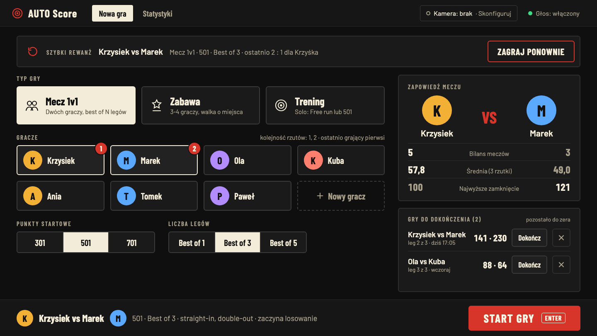

# AUTO Score

AUTO Score automatycznie liczy wynik w darcie. Dziś trafienia wpisuje się ręcznie na klawiaturze w aplikacji (symulator trafień). Później źródłem trafień będzie kamera USB. Wyjście to wynik na żywo, głosowy odczyt wyniku i efekty dźwiękowe. Dziś projekt działa lokalnie: serwer, baza i front stoją na jednym komputerze w sieci domowej. W przygotowaniu jest wersja online na serwerze Mikr.us, za wspólnym hasłem (plan: [design/plan-online.md](design/plan-online.md)).

## Stan projektu

Działa na `main`:

- typy gier: mecz 1v1 (X01), zabawa dla 2-4 graczy z rankingiem miejsc, trening (Free run i Solo 501),
- ekran startowy (wariant A2) z kreatorem nowej gry: typ gry, gracze (imię, avatar emoji, gość), punkty startowe, liczba legów w meczu 1v1 i tryb treningu; lista gier do dokończenia,
- profile graczy: edycja imienia i avatara, archiwizacja zamiast usuwania, zapis gościa jako gracza,
- ekran gry: pasek wyników, trzy sloty rzutek, suma tury, podpowiedź zamknięcia, klawiatura (1-20, 25, Miss, S/D/T) ze stanem wciśnięcia, „Cofnij”, porzucenie gry i wznowienie jej później, zakończenie treningu,
- koniec lega i meczu: podsumowanie z wynikiem, średnimi i zamknięciami legów oraz „Rewanż”,
- historia gier i statystyki: ranking graczy, karta gracza (średnia, first 9, 180/140+/100+/60+, najwyższe zamknięcie, % doubli, najlepszy leg, forma), head-to-head z meczów 1v1,
- stan na żywo przez WebSocket, z ponownym połączeniem po zerwaniu,
- głos: nagrane polskie komunikaty wyniku tury, „Bust”, „Game shot” i zwycięzcy, z syntezatorem mowy jako zapasem, oraz efekty dźwiękowe; głos i efekty mają przełączniki i są domyślnie włączone na każdym urządzeniu,
- układ na telefon, tablet i monitor,
- opcjonalne wspólne hasło do aplikacji (token w nagłówku, ekran logowania), wyłączone lokalnie.

Jeszcze nie ma:

- Działających przycisków „Nowa runda” i „Do weryfikacji”. Na ekranie gry są nieaktywne, z etykietą „Wkrótce”.
- Ekranu ustawień (pozycja „Ustawienia” w menu ma etykietę „Wkrótce”).
- Obsługi `confidence`. Serwer zapisuje to pole, ale go nie używa (nie ma jeszcze statusu `pending`).
- Wersji online na Mikr.usie (w trakcie, PR-y P24-P30).
- Kamery. Detekcja przyjdzie w etapie 2.

## Wymagania

- Node 24. `nvm use` czyta wersję z `.nvmrc`.
- pnpm 12. Dokładna wersja jest w polu `packageManager` w `package.json`.
- Dziś macOS. Docelowo mini PC z Linuksem.

## Instalacja i uruchomienie

```sh
nvm use
pnpm install
pnpm dev
```

`pnpm dev` uruchamia równolegle serwer (`http://localhost:3000`) i front (domyślnie `http://localhost:5173`). Aplikację otwierasz pod adresem frontu.

Tablet w tej samej sieci otwiera `http://<adres-IP-komputera>:5173`. Tablet potrzebuje tylko portu 5173, bo front przekazuje zapytania do API przez proxy `/api`. Jeśli macOS pyta o połączenia przychodzące, zezwól na nie w zaporze (Ustawienia systemowe, Sieć, Zapora).

Serwer przy starcie wykonuje migracje bazy. Plik bazy powstaje domyślnie w `packages/server/autoscore.sqlite`, bo pnpm uruchamia skrypty w katalogu pakietu. Pliki `*.sqlite` są w `.gitignore`.

Sam serwer, bez frontu i bez trybu watch:

```sh
pnpm --filter @autoscore/server start
```

## Konfiguracja

Konfiguracja idzie przez zmienne środowiskowe.

| Zmienna | Domyślnie | Znaczenie |
|---|---|---|
| `PORT` | `3000` | Port serwera API. |
| `HOST` | `0.0.0.0` | Adres nasłuchu serwera. Domyślny pozwala połączyć się z innych urządzeń w sieci. |
| `DATABASE_PATH` | `autoscore.sqlite` | Ścieżka pliku SQLite, względna wobec katalogu, w którym działa proces serwera. |
| `AUTOSCORE_API_URL` | `http://localhost:3000` | Adres serwera, na który proxy Vite przekazuje `/api` (tylko `pnpm dev`). |

`PORT` musi składać się z samych cyfr i nie przekraczać 65535. Inaczej serwer kończy pracę przy starcie z błędem `Invalid PORT`. Po zmianie `PORT` ustaw `AUTOSCORE_API_URL` na ten sam port, na przykład:

```sh
PORT=3100 AUTOSCORE_API_URL=http://localhost:3100 pnpm dev
```

Hasło do aplikacji i CORS (`AUTOSCORE_PASSWORD`, `AUTOSCORE_TOKEN_SECRET`, `AUTOSCORE_CORS_ORIGIN`) opisuje [README serwera](packages/server/README.md). Bez nich serwer działa bez logowania, jak lokalnie. Adres API i ścieżkę bazową buildu frontu (`VITE_API_URL`, `VITE_BASE`) opisuje [README frontu](packages/web/README.md).

## API w skrócie

Typy żądań, odpowiedzi i wiadomości są zdefiniowane tylko w [packages/schema](packages/schema/README.md) (Zod).

| Metoda | Ścieżka | Opis |
|---|---|---|
| `GET` | `/health` | `{ "status": "ok" }`. Nigdy nie wymaga hasła. |
| `POST` | `/auth/login` | Logowanie wspólnym hasłem (`LoginRequest`), odpowiedź z tokenem (`LoginResponse`). Istnieje tylko z ustawionym hasłem. |
| `GET` | `/players` | Lista graczy bez gości, posortowana po imieniu. `?archived=include` dołącza zarchiwizowanych. |
| `POST` | `/players` | Nowy gracz (`CreatePlayerRequest`: `name` 1-40 znaków po obcięciu spacji, opcjonalny `avatar` 1-16 znaków, `guest` domyślnie `false`). Odpowiedź 201 z `Player`. |
| `PATCH` | `/players/:id` | Zmiana profilu (`UpdatePlayerRequest`: imię, avatar, archiwizacja, zapis gościa). Odpowiedź z `Player`. |
| `GET` | `/players/:id/stats` | Statystyki gracza (`PlayerStats`), `?type=all\|match\|casual\|practice`. |
| `GET` | `/players/:id/form` | Forma gracza z ostatnich gier (`PlayerForm`), ten sam filtr `type`. |
| `GET` | `/players/:id/head-to-head/:opponentId` | Bilans dwóch graczy z meczów 1v1 (`HeadToHead`). |
| `GET` | `/stats/rankings` | Ranking graczy (`StatsRankings`), filtr `type`. |
| `POST` | `/matches` | Nowa gra (`CreateMatchRequest`, rodzaj w polu `type`). Odpowiedź 201 z `MatchSnapshot`. |
| `GET` | `/matches` | Lista gier (`MatchListItem[]`), filtry `?status=unfinished`, `playerId`, `type`. |
| `GET` | `/matches/:id` | Bieżący stan gry (`MatchSnapshot`). |
| `GET` | `/matches/:id/summary` | Podsumowanie gry (`MatchSummary`): wynik, średnie, legi. |
| `POST` | `/matches/:id/throws` | Rzutka (`HitEvent`). Odpowiedź 201 z `{ throw, events, state }`. |
| `POST` | `/matches/:id/undo` | Cofnięcie ostatniej rzutki. Body jest ignorowane. Odpowiedź 200 z `{ undoneThrowId, state }`. |
| `POST` | `/matches/:id/abandon` | Porzucenie gry (`AbandonMatchRequest`: `playerId` gracza, który przerywa, opcjonalny powód). Odpowiedź z `MatchSnapshot`. |
| `POST` | `/matches/:id/resume` | Wznowienie porzuconej gry. Odpowiedź z `MatchSnapshot`. |
| `POST` | `/matches/:id/end` | Zakończenie treningu. Odpowiedź z `MatchSnapshot`. |
| WebSocket | `/matches/:id/live` | Strumień stanu i zdarzeń jednej gry. |

Z ustawionym hasłem każde żądanie poza `/health` i `/auth/login` wymaga nagłówka `Authorization: Bearer <token>`, a WebSocket wysyła token w pierwszej wiadomości. Szczegóły: [README serwera](packages/server/README.md).

Rodzaje gry w `POST /matches`:

- `match`: dokładnie 2 różnych graczy w `playerIds`, `startingScore` 301, 501 lub 701 (domyślnie 501), `bestOf` 1, 3 lub 5 (domyślnie 3),
- `casual`: 2-4 różnych graczy i `startingScore`,
- `practice`: `practiceMode` `free_run` albo `solo_501` i jeden gracz.

### Zdarzenie trafienia (`HitEvent`)

```json
{
  "eventId": "6f1c2a9e-3b4d-4e5f-8a7b-9c0d1e2f3a4b",
  "matchId": "<MATCH_ID>",
  "source": "keypad",
  "sequence": 0,
  "segment": 20,
  "multiplier": 3,
  "confidence": 1,
  "detectedAt": "2026-10-18T18:30:12.345Z"
}
```

- `eventId`: UUID (małe lub wielkie litery). Ten sam `eventId` wysłany ponownie do tej samej gry nie dubluje rzutki.
- `source`: niepusty tekst, na przykład `keypad` albo `camera-1`.
- `sequence`: liczba całkowita od 0.
- `segment`: 0-20 albo 25. `multiplier`: 0-3.
- `confidence`: liczba od 0 do 1.
- `detectedAt`: data ISO w UTC zakończona `Z`. Przesunięcie strefy, na przykład `+02:00`, jest odrzucane.

Kodowanie: miss to `segment: 0, multiplier: 0`. Outer Bull to `segment: 25, multiplier: 1` (25 pkt). Bull to `segment: 25, multiplier: 2` (50 pkt, liczy się jako double). `segment: 25, multiplier: 3` jest odrzucane.

### Idempotencja i błędy

Ponowne wysłanie rzutki z tym samym `eventId` do tej samej gry daje 200 z zapisaną rzutką i `events: []`. Serwer nic wtedy nie zapisuje i nic nie wysyła przez WebSocket. Cofnięcie jest nowym wpisem w logu. Wiersz rzutki zostaje w bazie.

Każdy błąd ma postać `{ "error": "<kod>", "message": "<opis>" }` (`ApiError`).

| Kod | HTTP | Kiedy |
|---|---|---|
| `invalid_request` | 400 | Body nie pasuje do schematu, niepoprawny JSON, brak lub zły `content-type`. |
| `invalid_config` | 400 | Silnik odrzucił konfigurację gry. |
| `unknown_player` | 400 | `playerIds` zawiera nieznanego gracza. |
| `match_mismatch` | 400 | `matchId` w body różni się od `:id` w adresie. |
| `not_a_participant` | 400 | Porzucenie z `playerId` gracza, który nie gra w tej grze. |
| `unauthorized` | 401 | Hasło włączone, a brak tokena albo token jest nieważny. |
| `invalid_password` | 401 | Złe hasło przy logowaniu. |
| `forbidden_origin` | 403 | WebSocket z originu spoza `AUTOSCORE_CORS_ORIGIN`. |
| `not_found` | 404 | Nieznana gra lub gracz albo nieznana ścieżka. |
| `match_finished` | 409 | Rzutka po końcu gry. |
| `match_abandoned` | 409 | Rzutka, cofnięcie, ponowne porzucenie albo zakończenie treningu w porzuconej grze. |
| `match_not_abandoned` | 409 | Wznowienie gry, która nie jest porzucona. |
| `practice_ended` | 409 | Rzutka, cofnięcie, porzucenie albo ponowne zakończenie po zakończeniu treningu. |
| `not_practice` | 409 | Zakończenie gry, która nie jest treningiem. |
| `nothing_to_end` | 409 | Zakończenie treningu bez żadnej rzutki. |
| `event_id_conflict` | 409 | `eventId` jest już użyty w innej grze. |
| `nothing_to_undo` | 409 | W logu nie ma rzutki do cofnięcia. |
| `too_many_attempts` | 429 | Ponad 10 nieudanych logowań w minucie. |
| `internal_error` | 500 | Nieoczekiwany błąd serwera. |

Żądania POST z body muszą mieć nagłówek `content-type: application/json`. Bez niego curl wysyła dane formularza, a serwer odpowiada 400 `invalid_request` („Unsupported Media Type”). Cofnięcie działa z tym nagłówkiem i bez niego.

### WebSocket

Adres bezpośredni: `ws://localhost:3000/matches/:id/live`. Przez proxy frontu: `/api/matches/:id/live`.

- Po połączeniu serwer wysyła jedno `state_updated` z bieżącym stanem.
- Po każdej nowej rzutce: `throw_registered`, potem zdarzenia domenowe, potem `state_updated`. Wszystkie mają ten sam `eventSeq`.
- Po cofnięciu: `throw_undone`, potem `state_updated`.
- Nieznana gra: serwer zamyka połączenie z kodem 4404.
- Z ustawionym hasłem pierwsza wiadomość klienta to `{ "type": "auth", "token": "…" }`. Bez niej w ciągu 5 s albo ze złym tokenem serwer zamyka połączenie kodem 4401.
- Serwer wysyła ping co 30 s, żeby proxy nie zrywało bezczynnych połączeń.

Zdarzenia domenowe: `turn_completed`, `bust`, `leg_won`, `match_won`, `player_finished`, `casual_finished`. Pełna unia wiadomości to `LiveMessage`.

### Przykład z curl

Serwer musi działać na `http://localhost:3000`. Identyfikatory z odpowiedzi wstaw w miejsce `<PLAYER_1_ID>`, `<PLAYER_2_ID>`, `<MATCH_ID>`.

1. Dwóch graczy (201):

   ```sh
   curl -i -X POST http://localhost:3000/players -H 'content-type: application/json' -d '{"name":"Anna","avatar":"🎯"}'
   curl -i -X POST http://localhost:3000/players -H 'content-type: application/json' -d '{"name":"Bartek"}'
   ```

2. Mecz 1v1 (201):

   ```sh
   curl -i -X POST http://localhost:3000/matches -H 'content-type: application/json' \
     -d '{"type":"match","playerIds":["<PLAYER_1_ID>","<PLAYER_2_ID>"],"startingScore":501,"bestOf":3}'
   ```

3. Jedna rzutka, T20 (201). Własny `eventId` daje `uuidgen`, a bieżący czas w UTC `date -u +%Y-%m-%dT%H:%M:%SZ`. Ten sam `eventId` w kolejnej grze daje 409 `event_id_conflict`, więc przy następnej grze wstaw nowy UUID.

   ```sh
   curl -i -X POST http://localhost:3000/matches/<MATCH_ID>/throws -H 'content-type: application/json' \
     -d '{"eventId":"6f1c2a9e-3b4d-4e5f-8a7b-9c0d1e2f3a4b","matchId":"<MATCH_ID>","source":"curl","sequence":0,"segment":20,"multiplier":3,"confidence":1,"detectedAt":"2026-10-18T18:30:12Z"}'
   ```

4. To samo body jeszcze raz (200 z `"events":[]`): powtórz polecenie z kroku 3.

5. Cofnięcie (200 z `undoneThrowId` równym `id` rzutki z kroku 3):

   ```sh
   curl -i -X POST http://localhost:3000/matches/<MATCH_ID>/undo
   ```

## Struktura repozytorium

```
packages/
  engine/   silnik gry: czysta logika X01, zabawy i treningu
  schema/   kontrakt: schematy Zod i typy wspólne dla wszystkich pakietów
  server/   API REST i WebSocket, log zdarzeń w SQLite
  web/      front React (ekran gry, kreator, klawiatura)
  audio/    głos i efekty dźwiękowe z wiadomości na żywo
design/     tokeny motywu i makiety
spikes/     eksperymenty z kamerą, poza buildem i lintem
rollout/    manifest planu PR-ów
```

Pakiet `vision` i katalog `fixtures` dojdą w etapie 2 (kamera).

README pakietów: [engine](packages/engine/README.md), [schema](packages/schema/README.md), [server](packages/server/README.md), [web](packages/web/README.md), [audio](packages/audio/README.md).

## Komendy

```sh
pnpm test        # testy wszystkich pakietów (Vitest)
pnpm typecheck   # tsc w każdym pakiecie
pnpm lint        # ESLint na całym repo
pnpm --filter @autoscore/engine test   # testy jednego pakietu
```

CI uruchamia te same trzy checki (`test`, `typecheck`, `lint`) oraz `build` (build frontu) i `smoke` (start serwera na pustej bazie i `GET /players`).

## Zasady gry (X01) w skrócie

- Wyjście double-out: leg zamyka double albo Bull.
- Bust, gdy wynik spadłby poniżej zera, zostałaby dokładnie 1 albo zero padłoby bez doubla. Gracz wraca do wyniku sprzed tury, a tura się kończy.
- Rzutka poza tarczą lub odbita to miss za 0 pkt.
- Wejście straight-in: punkty liczą się od pierwszej rzutki.
- Punkty startowe: 301, 501 lub 701.
- Mecz 1v1: best of 1, 3 lub 5 legów (domyślnie 3). Pierwszego rzucającego losuje serwer, kolejne legi zaczynają gracze na przemian.
- Zabawa dla 2-4 graczy: kto zamknie leg, zajmuje kolejne miejsce i wypada z kolejki. Ostatni grający dostaje ostatnie miejsce.
- Trening: Free run to swobodne rzucanie bez końca, które nie liczy się do statystyk. Solo 501 to zejście z 501 do zera na zasadach X01.

Pełne zasady są w [CLAUDE.md](CLAUDE.md).

## Motyw i makiety

[design/theme.css](design/theme.css) to jedyne źródło kolorów, fontów, rozmiarów i promieni (motyw A, ciemny klasyczny). Front importuje go w `packages/web/src/theme.css`. Kolor nie może sam nieść znaczenia: bust, wygrana i weryfikacja mają mieć też ikonę i tekst.

Makiety są w [design/mockups](design/mockups). Liczby i gracze na nich są przykładowe. Makiety ekranu gry nie mają klawiatury ręcznego wpisu, dodanej w tym samym stylu.

**Ekran gry:** [2 graczy](design/mockups/theme-a-2-players.png), [4 graczy](design/mockups/theme-a-4-players.png).


**Ekran startowy (Home, „Nowa gra”):** obowiązuje wariant A2: [makieta](design/mockups/theme-a2-new-game.png) ([HTML](design/mockups/theme-a2-new-game.html)), zakres w [design/new-game-a2.md](design/new-game-a2.md). Wcześniejszy wariant: [makieta](design/mockups/theme-a-new-game.png) ([HTML](design/mockups/theme-a-new-game.html)), [wariant z 10 graczami](design/mockups/theme-a-new-game-10-players.png) ([HTML](design/mockups/theme-a-new-game-10-players.html)).



**Statystyki:** [makieta](design/mockups/theme-a-stats.png) ([HTML](design/mockups/theme-a-stats.html)).


Makiety ekranu startowego i statystyk powstały przed decyzjami z planu. Obowiązuje opis w [auto-score-dart-pomysly.md](auto-score-dart-pomysly.md), sekcja „Ekran startowy i statystyki: punkty do implementacji” wraz z „Decyzjami” (np. statystyki to lista graczy według średniej i 4 kafelki top 3).

## Jak rozwijamy projekt

Projekt rośnie małymi PR-ami, po jednym kroku w każdym. PR trafia do `main` dopiero przy zielonych `test`, `typecheck`, `lint`, `build` i `smoke`. Plan i decyzje są w [auto-score-dart-pomysly.md](auto-score-dart-pomysly.md), a zasady dla osób i agentów rozwijających kod w [CLAUDE.md](CLAUDE.md).
